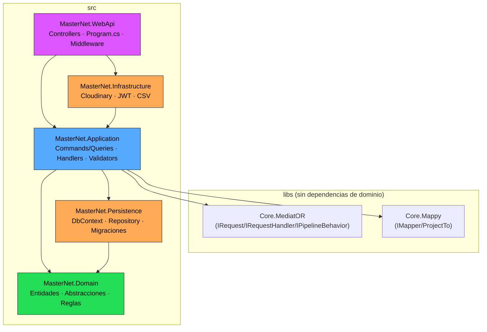
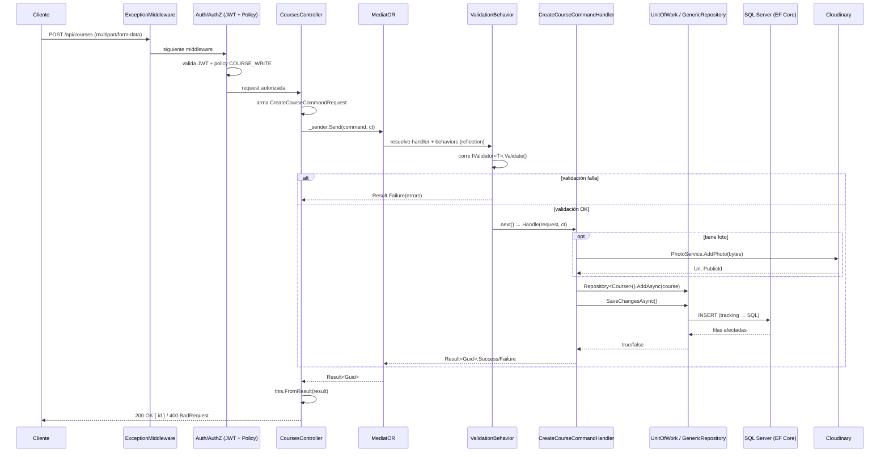

# MasterNet — Arquitetura

## Resumo

MasterNet é uma API backend em **ASP.NET Core (.NET 10)** para gestão de cursos online (cursos, instrutores, preços, ratings, fotos, contas de usuário). Segue **Clean Architecture / Onion Architecture** com **CQRS em vertical slices**, e substitui duas peças típicas do ecossistema (MediatR e AutoMapper) por implementações próprias (`Core.MediatOR`, `Core.Mappy`), o que sugere um propósito didático além de funcional.

## Projetos da solução

```
MasterNet.sln
├── src/
│   ├── MasterNet.Domain          (núcleo — sin dependencias)
│   ├── MasterNet.Persistence     (EF Core, DbContext, migraciones, seed)
│   ├── MasterNet.Application     (casos de uso, CQRS, validación)
│   ├── MasterNet.Infrastructure  (servicios externos: Cloudinary, JWT, CSV)
│   └── MasterNet.WebApi          (Controllers, Program.cs, middleware)
├── libs/
│   ├── Core.MediatOR             (mediator propio: IRequest/IRequestHandler/IPipelineBehavior)
│   └── Core.Mappy                (mapper propio: IMapper/ProjectTo/IMappingProfile)
└── tests/
    └── MasterNet.Application.UnitTests
```

### Responsabilidade de cada camada

| Projeto | Depende de | Responsabilidade |
|---|---|---|
| **Domain** | nada | Entidades (`Course`, `Instructor`, `Price`, `Rating`, `Photo`, `Device`), abstrações (`BaseEntity`, `IGenericRepository`, `IUnitOfWork`, `ISpecification`), regras de segurança (`PolicyMaster`, `CustomRoles`, `CustomClaims`). |
| **Persistence** | Domain | `MasterNetDbContext` (herda `IdentityDbContext<AppUser>`), configuração Fluent API das entidades, migrations EF Core, `GenericRepository`/`UnitOfWork`, seed de dados (Bogus + JSON). |
| **Application** | Domain, Persistence, libs | Casos de uso organizados **por feature** (`Courses/CourseCreate`, `Courses/GetCourses`, `Accounts/Login`, ...), cada um com Command/Query + Handler + Validator em um único arquivo. Contém o `Result<T>` pattern e o `ValidationBehavior`. |
| **Infrastructure** | Application | Implementações de serviços externos: `PhotoService` (Cloudinary), `TokenService`/`UserAccessor` (JWT), `ReportService` (CSV). |
| **WebApi** | Application, Infrastructure | Controllers, `Program.cs` (composição da aplicação e DI), middleware de exceções, extensões de configuração (Identity, políticas de autorização, seed na inicialização). |

## Padrão arquitetural

**Clean Architecture (Onion)** — a dependência sempre aponta para dentro (Domain não conhece ninguém; WebApi conhece todos). Além disso, **CQRS em vertical slices**: em vez de organizar por camada técnica (todos os Commands juntos, todos os Handlers juntos), cada caso de uso vive em sua própria pasta com tudo o que precisa.

Particularidade: `Application` referencia diretamente `Persistence` (não é uma Clean Architecture 100% pura, em que Application deveria conhecer apenas interfaces). Isso habilita um híbrido pragmático:
- **Escritas** → passam por `IUnitOfWork.Repository<T>()` (Repository + Unit of Work, enxuto: apenas `GetByIdAsync`/`AddAsync`).
- **Leituras complexas** (paginação, filtros, projeções) → injetam `MasterNetDbContext` diretamente e usam LINQ + `ProjectTo<TDto>()`, sem passar pelo repositório genérico.

## Diagrama de camadas



## Fluxo de uma requisição (exemplo: `POST /api/courses`)



## Principais decisões de design

- **Mediator e Mapper caseiros** (`Core.MediatOR`, `Core.Mappy`) em vez de MediatR/AutoMapper. O mediator resolve handlers e pipeline behaviors via DI + reflection, montando uma cadeia de responsabilidade idêntica em espírito ao MediatR.
- **`Result<T>` pattern** para erros de negócio (validação, "não encontrado" etc.) — nunca se usam exceções para fluxo de controle esperado. `ExceptionMiddleware` captura apenas falhas verdadeiramente inesperadas e devolve um JSON 500 uniforme.
- **Validação como pipeline behavior** desacoplado (`ValidationBehavior<,>`), não vive no controller nem no handler — é ativada automaticamente se existir um `IValidator<T>` registrado para essa request.
- **Repository/UnitOfWork enxuto para escritas, acesso direto ao `DbContext` para leituras** — CQRS pragmático: não se força o padrão Repository onde ele não agrega valor (queries com filtros dinâmicos, `Include`, projeção para DTO).
- **Autorização por claims granulares**, não por role: os roles (`ADMIN`, `CLIENT`) apenas agrupam claims `POLICIES` (`COURSE_WRITE`, `RATING_CREATE` etc.) que são atribuídos ao usuário no momento da emissão do JWT. As políticas de autorização (`[Authorize(Policy = ...)]`) verificam esses claims diretamente.
- **JWT sem estado nem revogação**: token assinado com HMAC-SHA256, expira em 7 dias, sem refresh tokens.
- **Value Object real apenas em `Device`** (`DeviceName`, mapeado com `OwnsOne`) — as demais entidades são POCOs anêmicos com setters públicos.
- **Specification pattern definido, mas subutilizado**: existe `ISpecification<T>` em Domain, com uma única implementação (`DeviceByNameContainsSpec`), e nem sequer é resolvido por meio do repositório genérico — o `.Criteria` é aplicado manualmente sobre o `DbContext`.

## Dependências externas

| Tipo | Serviço | Uso |
|---|---|---|
| Banco de dados | SQL Server (Docker, `azure-sql-edge`) | Persistência principal via EF Core, incluindo as tabelas do Identity |
| API de terceiros | Cloudinary | Armazenamento de imagens dos cursos |
| Fila de mensagens | — | Não se aplica |
| Cache | — | Não se aplica |

## Notas / dívida técnica conhecida

- `MasterNet.Infrastructure.DependencyInjection.AddInfrastructure()` está vazio — os serviços de infraestrutura são registrados diretamente em `Program.cs` em vez de serem encapsulados ali.
- `TokenKey` (chave de assinatura JWT) não é mais commitada: `appsettings.json` traz apenas um placeholder vazio e a aplicação falha na inicialização com uma mensagem explícita se ela não for definida. O valor real de desenvolvimento fica em `src/MasterNet.WebApi/appsettings.Local.json` (gitignored; .NET User Secrets não é usado neste repositório, ver `CLAUDE.md`).
- O CORS lê `Cors:AllowedOrigins` da configuração; em Development, se não for definido, recorre a `AllowAnyOrigin/Method/Header`. Em Staging/Production a aplicação exige a lista explícita e falha na inicialização se ela estiver ausente.
- Credenciais de seed (usuário admin e senhas) hardcoded em `SeedDatabase.cs` — esperado neste setup local/didático. A connection string do SQL Server com a senha real não está mais em `appsettings.json` (placeholder `CHANGE_ME`); ela fica em `appsettings.Local.json` para desenvolvimento local.
